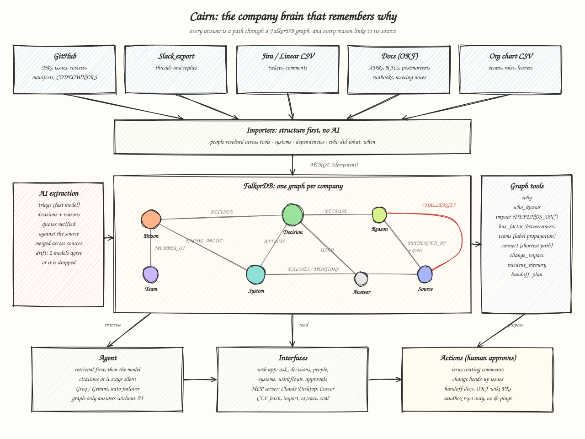

# Cairn

**The company brain that remembers *why*.** Built on [FalkorDB](https://falkordb.com) for Graph Hacks, Track 03: Company Brain.

Teams lose the reasons behind their decisions. The Slack thread that settled it scrolls away, the person who
argued for it leaves, and two years later someone "fixes" it back. Cairn reads the places where engineering
work actually happens (GitHub, Slack, Jira, ADRs, postmortems, runbooks, the org chart) into one FalkorDB graph
of people, systems, decisions and the evidence behind them. Ask it a question and the answer is a path through
that graph, with every claim linked to the message, ticket or document that supports it.



## What it does

| Ask | What Cairn does |
|---|---|
| **Why is it like this?** | Decisions with their reasons, rejected alternatives and who decided, each backed by a verbatim quote. One decision is traced across every place it was discussed: the Slack argument, the RFC, the ADR, the ticket. |
| **Is that still true?** | Drift detection flags decisions whose reasons were later contradicted (a postmortem, a migration, a benchmark). Two models must agree and the quote must verify, or the flag is dropped. |
| **Who knows this?** | Expertise per system from who built, reviewed, decided and explained it, recency-weighted, with the work that justifies the ranking. People who left are shown as such, not recommended. |
| **What breaks?** | Transitive dependencies (`DEPENDS_ON*`), owning teams, open work and the decisions that constrain the change. |
| **Where are we fragile?** | Bus factor per system, bridge people (betweenness), inferred teams (label propagation). |

Three workflows turn that into work people already do:

- **Change impact.** "We're moving the events pipeline to MSK." Cairn returns the blast radius, the teams and people to tell, the past decisions you'd be overturning, and a heads-up issue draft.
- **Incident memory.** Paste an alert. Cairn finds similar past incidents, how they were resolved, who fixed them, and flags runbooks that are stale (author left, older than the latest postmortem, or based on a decision that drifted).
- **Handoff plan.** Someone is leaving. Cairn lists what only they know, their open work, the decisions they made, and who should take each area, as a handoff doc ready for a PR.

Every write (an issue, a routing comment, a handoff doc, the OKF wiki) is a *proposal* until a human approves it.

## Two workspaces, one graph each

| Workspace | Data | Shows |
|---|---|---|
| **FalkorDB** (`cairn`) | 13 real repositories of the FalkorDB GitHub org: PRs, issues, reviews, discussions, docs, package manifests, CODEOWNERS | Cairn on real, messy open-source history |
| **Orbiton** (`cairn_orbiton`) | A fictional 24-person logistics company in real export formats: Slack export, Jira CSV, ADRs, RFCs, postmortems, runbooks, meeting notes, org chart | The full company-brain story across tools, including a key engineer who left |

Orbiton is generated by `cairn sample orbiton` and committed in [`workspaces/orbiton`](workspaces/orbiton), so you can
read the raw "company" yourself. Each workspace is its own FalkorDB graph, switchable in the UI, and nothing leaks between them.

## Quick start (no keys needed)

```bash
docker compose up -d --build              # FalkorDB :6379 (+ Browser :3000), API :8000, web :8080
docker compose run --rm api cairn demo    # build both workspaces from the snapshot, replay extraction
```

Open http://localhost:8080. `cairn demo` restores `demo/cairn-snapshot.tar.gz` (raw GitHub data plus cached model
responses), imports Orbiton, and replays extraction and drift, so it needs no GitHub token and no LLM key.
Without an LLM key, chat runs in graph-only mode: questions are routed straight to the graph tools and answered
deterministically. Add a free [Groq](https://console.groq.com/keys) key to `.env` for full answers.

### Your own data

```bash
cp .env.example .env                                   # add GROQ_API_KEY (and/or GEMINI_API_KEY), GITHUB_TOKEN
docker compose run --rm api cairn fetch                # GitHub -> data/raw (repos in CAIRN_REPOS)
docker compose run --rm api cairn load                 # -> graph + expertise, no AI
docker compose run --rm api cairn extract              # AI: decisions + reasons with verified quotes
docker compose run --rm api cairn drift                # AI: challenge reasons against later evidence

docker compose run --rm api cairn workspace import workspaces/acme   # Slack / Jira / docs / org chart
```

A workspace folder is plain exports, every part optional:

```
acme/
  workspace.toml        name, description
  people.csv            handle, name, email, team, role, manager, slack_id, jira_name, github, joined, left
  teams.csv             key, name, description
  systems.csv           key, name, kind, team, depends_on, aliases, description
  tickets.csv           Jira / Linear CSV export (repeated Comment columns are fine)
  slack/                Slack workspace export (users.json, channels.json, channel/day.json)
  docs/                 markdown: adr/, rfc/, postmortems/, runbooks/, meetings/, anything else
```

People are matched across tools (Slack ID, Jira display name, GitHub login, email) so one person is one node.
ADRs and RFCs are parsed into decisions without AI (status, context, decision, alternatives); a postmortem's
`challenges:` frontmatter links it to the decisions it contradicts.

## How it works

**Structure first, AI second.** Authors, reviewers, merges, touched modules, replies, ticket assignees, team
membership and cross-repo dependencies come straight from the data, so most of the graph cannot be hallucinated.
The AI only does what needs judgement: finding decisions and the reasons for them.

**Grounding is enforced in code, not in the prompt.** Each extracted reason must quote a labelled segment of
the source verbatim, and [`extract/grounding.py`](backend/src/cairn/extract/grounding.py) checks the quote against the
text; claims that fail are dropped. A decision restated in another place (the ADR after the Slack thread) is
merged into the existing node as extra evidence rather than duplicated. At answer time every source gets a
citation number, citations the model invents are stripped, and the agent says it doesn't know when no recorded
decision covers the topic. Each answer is written back as an `(:Answer)-[:USED]->(…)` audit trail.

**Retrieval first, then the model.** A deterministic router recognises the question type (why, who, impact,
incident, change, handoff) and runs the right graph tools before the model sees anything. The model then
writes the answer from that evidence and may call more tools. If no model is available the router's evidence
is rendered directly, so the product still works.

**Graph algorithms do real work.** `algo.betweenness` finds bridge people, `algo.labelPropagation` over a
`WORKS_WITH` projection infers teams, `shortestPath` explains how two things connect, and `DEPENDS_ON*`
traversals compute blast radius.

**Writes need a human.** The agent can only *propose* actions. Each is stored as a pending `(:Action)` with a
full preview; nothing reaches GitHub until someone approves it in the UI or CLI, and writes are refused outside
`CAIRN_ACTION_REPOS`. Published text never @-mentions anyone, and links to other repos go through
`redirect.github.com`, so Cairn never pings people or adds backlinks to their repos.
Live examples: [routed issues, handoff docs and the OKF wiki PR](https://github.com/kh-bikash/cairn-sandbox).

## Evaluation

[`eval/questions.jsonl`](eval/questions.jsonl) holds questions whose answers were written from the raw data,
not from Cairn's output. They cover why, who, impact, history, multi-hop and risk, plus trick questions with
false premises that must be declined.

```bash
cd backend && uv run cairn eval --systems cairn,rag,router   # writes eval/results.md
```

It compares **cairn** (graph agent), **rag** (keyword retrieval over the same documents plus one call to the
same model) and **router** (Cairn's graph routing with no AI at all). Results: [`eval/results.md`](eval/results.md).

## Use it from your AI tools (MCP)

```bash
cd backend && uv run cairn mcp                       # stdio
uv run cairn mcp --transport streamable-http         # HTTP
```

```json
{ "mcpServers": { "cairn": { "command": "uv", "args": ["--directory", "/path/to/company-brain/backend", "run", "cairn", "mcp"] } } }
```

Tools: `search`, `why`, `who_knows`, `impact`, `change_impact`, `incident_memory`, `handoff_plan`, `suggest_owners`,
`details`, `person_profile`, `timeline`, `bus_factor`, `drift_report`, `teams`, `connect`, `list_systems`.
All are read-only and return their sources. Set `CAIRN_GRAPH_NAME=cairn_orbiton` to serve the Orbiton workspace.

## OKF wiki

`cairn okf export` writes the brain as an [Open Knowledge Format](https://www.gitbook.com/blog/what-is-okf-open-knowledge-format)
bundle: cross-linked markdown with YAML frontmatter for systems, decisions (reasons, quotes, drift warnings),
people and a decision log. The export is deterministic, so the agent's wiki PRs show only real changes.

## Graph model

| Node | Key | Notes |
|---|---|---|
| `Person` | `handle` | role, team, joined/left; bots filtered out |
| `Team` | `key` | declared (org chart) or inferred (label propagation) |
| `System` | `key` | services, repos, modules; `DEPENDS_ON {via}` |
| `Source` | `uid` | PR, issue, discussion, doc, Slack thread, ticket, ADR/RFC, postmortem, runbook, meeting; replies via `REPLY_TO` |
| `Decision` | `uid` | `status`, `drift`, `confidence` = verified claims / claimed |
| `Premise` | `uid` | a reason (`BECAUSE`) or a rejected option (`REJECTED`) |
| `Action` | `uid` | a proposed write and its approval status |
| `Answer` | `uid` | the agent's own answers, linked to the nodes they used |

Relationships: `AUTHORED`, `REVIEWED`, `MERGED`, `ASSIGNED`, `REPLY_TO`, `CLOSES`, `REFERENCES`, `TOUCHES`, `MENTIONS`,
`IN_REPO`, `PART_OF`, `MEMBER_OF`, `REPORTS_TO`, `OWNS`, `DEPENDS_ON`, `SUPERSEDES`, `KNOWS_ABOUT {score, lifetime, last_ts, …}`, `WORKS_WITH {weight}`,
`DECIDED`, `DECIDED_IN`, `DISCUSSED_IN`, `BECAUSE`, `REJECTED`, `EVIDENCED_BY {quote}`, `CHALLENGES {quote, verdict}`,
`AFFECTS`, `USED`.

On Orbiton, this finds Priya's Kafka decision for the events pipeline, which six services still depend on after she left:

```cypher
// Which decisions did people who have left make about systems we still depend on?
MATCH (p:Person)-[:DECIDED]->(d:Decision)-[:AFFECTS]->(s:System)<-[:DEPENDS_ON*1..3]-(dep:System)
WHERE p.left IS NOT NULL
RETURN p.name, d.title, s.key, collect(DISTINCT dep.key) AS still_depends
```

## Deploying publicly

- Set `CAIRN_ADMIN_TOKEN`. Reading and asking stay open; every write (sync, proposals, approvals) then needs
  the token, which admins paste once under Settings.
- `/api/ask` is rate-limited per client (`CAIRN_ASK_RATE_LIMIT_PER_MINUTE`, default 20) to protect LLM quota.
- `CAIRN_CORS_ORIGINS` lists the web origins allowed to call the API.
- Workspace selection is validated against the graphs that exist in FalkorDB.

## Development

```bash
docker compose up -d falkordb
cd backend && uv sync
uv run cairn doctor                  # checks FalkorDB, GitHub token, LLM keys
uv run cairn demo
uv run cairn ask "Why did we move the events pipeline to MSK?"
uv run cairn serve --reload          # API on :8000

cd ../web && npm install && npm run dev   # UI on :5173, proxies /api to :8000 (CAIRN_API overrides)
```

Quality gates: `uv run pytest` (unit + FalkorDB integration; set `CAIRN_FALKORDB_PORT` if FalkorDB isn't on 6379),
`uv run ruff check`, `uv run mypy` (strict), and `npm run build` for the web app.
`node docs/diagram.mjs` regenerates the diagram above (needs `npm i --no-save roughjs@4.6.6`).

### Models (free tiers are enough)

Every AI role is a comma-separated fallback chain of `provider:model` refs over OpenAI-compatible endpoints
(`groq`, `gemini`, `openai`, `anthropic`, `typesafe`). If a model is overloaded or returns invalid JSON, Cairn
moves to the next one; if it reports its daily quota is used up, Cairn skips it for the rest of the run.
Responses at temperature 0 are cached under `data/llm-cache`, so re-runs cost nothing and snapshots replay offline.

| Role | Used for | Default |
|---|---|---|
| `CAIRN_MODEL_DECIDE` | bounded choices: triage, drift verdicts (the slot for TypeSafe JEV) | Groq `gpt-oss-20b` → `gpt-oss-120b` → Gemini |
| `CAIRN_MODEL_EXTRACT` | decision extraction, second opinion on drift | Groq `gpt-oss-120b` → Qwen → Gemini |
| `CAIRN_MODEL_AGENT` | tool-calling agent and final answers | Groq `gpt-oss-120b` → Qwen → Gemini |

### FalkorDB notes

- The stock image sets a 1s query timeout; `docker-compose.yml` raises it (`TIMEOUT_DEFAULT 30000`).
- A filtered `OPTIONAL MATCH` (or a pattern comprehension with `WHERE`) after an aggregating `WITH` can return
  no rows. Cairn avoids that shape, and `tests/test_integration.py` asserts every tool returns data.
- `toLower()` fails with "Invalid UTF8 string" on some bodies containing emoji. Cairn computes text features in
  Python at load time instead, and replaces unpaired surrogates before writing.

## Scope, honestly

- Orbiton is fictional; its people and conversations are generated. The FalkorDB workspace is real public data.
- Live sync is built for GitHub. Slack, Jira and docs come in as exports (`cairn workspace import`), not live connectors.
- Expertise is inferred from activity, so it reflects who did the work, not formal ownership, unless an org chart or CODEOWNERS says otherwise.
