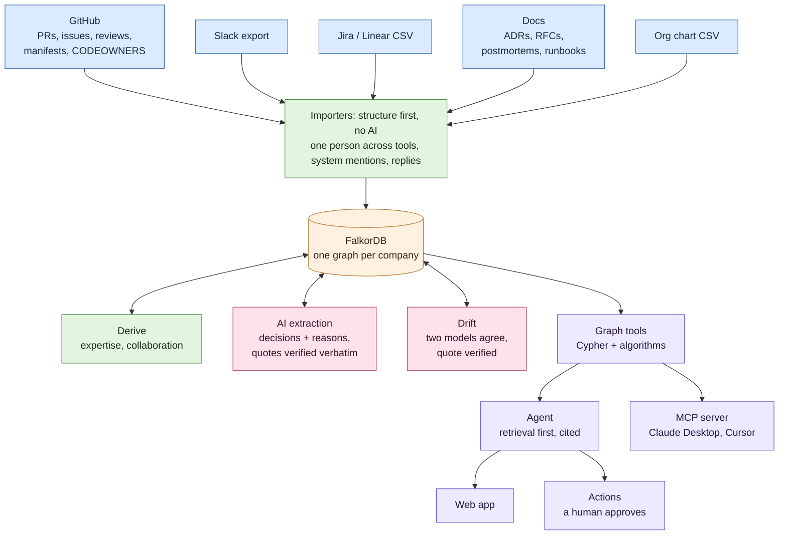
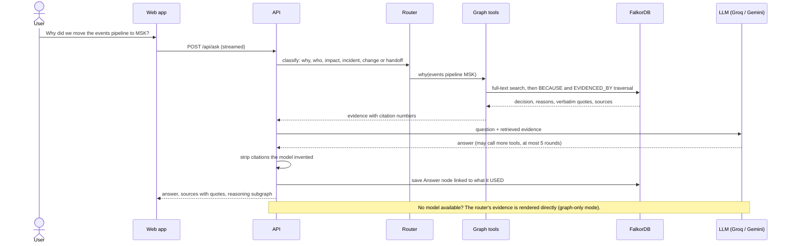
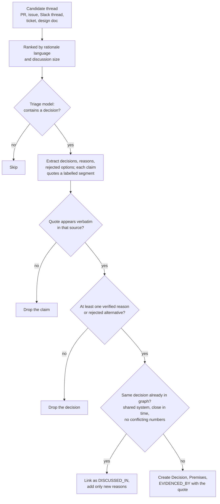
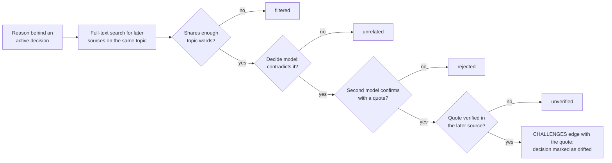
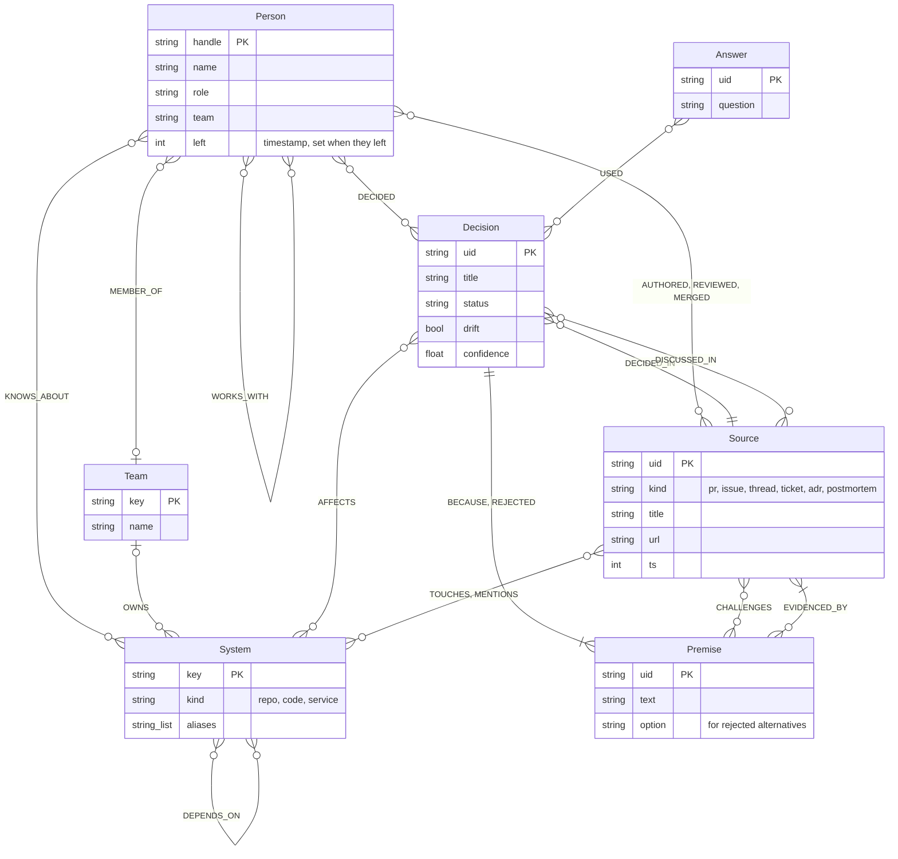
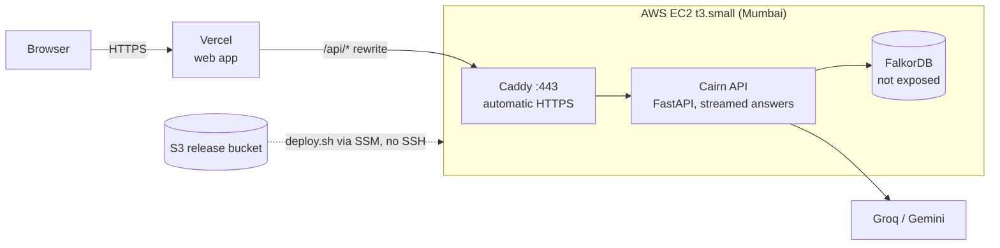

# Cairn

**The company brain that remembers *why*.** Built on [FalkorDB](https://falkordb.com) for Graph Hacks, Track 03: Company Brain.

**Live:** https://cairn-nine-mu.vercel.app (no sign-up; switch between the FalkorDB and Orbiton workspaces in the sidebar)

Teams lose the reasons behind their decisions. The Slack thread that settled it scrolls away, the person who
argued for it leaves, and two years later someone "fixes" it back. Cairn reads the places where engineering
work actually happens (GitHub, Slack, Jira, ADRs, postmortems, runbooks, the org chart) into one FalkorDB graph
of people, systems, decisions and the evidence behind them. Ask it a question and the answer is a path through
that graph, with every claim linked to the message, ticket or document that supports it.


**Contents:**
[What it does](#what-it-does) ·
[Quick start](#quick-start-no-keys-needed) ·
[How it works](#how-it-works) ·
[Graph data model](#graph-data-model) ·
[Cypher the product depends on](#cypher-the-product-depends-on) ·
[Evaluation](#evaluation) ·
[MCP](#use-it-from-your-ai-tools-mcp) ·
[Deployment](#deployment) ·
[Development](#development) ·
[Scope](#scope-honestly) ·
[AI assistance](#ai-assistance)

## What it does

| Ask | What Cairn does |
|---|---|
| **Why is it like this?** | Decisions with their reasons, rejected alternatives and who decided, each backed by a verbatim quote. One decision is traced across every place it was discussed: the Slack argument, the RFC, the ADR, the ticket. |
| **Is that still true?** | Drift detection flags decisions whose reasons were later contradicted (a postmortem, a migration, a benchmark). Two models must agree and the quote must verify, or the flag is dropped. |
| **Who knows this?** | Expertise per system from who built, reviewed, decided and explained it, recency-weighted, with the work that justifies the ranking. People who left are shown as such, not recommended. |
| **What breaks?** | Transitive dependencies (`DEPENDS_ON*`), owning teams, open work and the decisions that constrain the change. |
| **Where are we fragile?** | Bus factor per system, experts who left, bridge people (betweenness) and working groups (label propagation). |
| **Questions that need several hops** | Chained graph walks that show their steps: decisions made by people who left → what they affect → what still depends on it; runbooks → authors → newer postmortems → challenged decisions; a topic → the repos and people involved → the earlier work it refers to. The UI shows each hop as a numbered "How this was worked out" trace. |

Four workflows turn that into work people already do:

- **Change impact.** "We're moving the events pipeline to MSK." Cairn returns the blast radius, the teams and people to tell, the past decisions you'd be overturning, and a heads-up issue draft.
- **Incident memory.** Paste an alert. Cairn finds similar past incidents, how they were resolved, who fixed them, and flags runbooks that are stale (author left, older than the latest postmortem, or based on a decision that drifted).
- **Decision guard.** A new PR or ticket arrives. Cairn maps it to the systems it touches, loads their active decisions, and says whether the change looks like it reverses one (needs review), relates to one (heads-up) or is clear, with the reasons and deciders and a draft comment. No AI involved, and it never @-mentions anyone.
- **Handoff plan.** Someone is leaving. Cairn lists what only they know, their open work, the decisions they made, and who should take each area, as a handoff doc ready for a PR.

Every write (an issue, a routing comment, a handoff doc, the OKF wiki) is a *proposal* until a human approves it.

### Two workspaces, one graph each

| Workspace | Data | Shows |
|---|---|---|
| **FalkorDB** (`cairn`) | 13 real repositories of the FalkorDB GitHub org: PRs, issues, reviews, discussions, docs, package manifests, CODEOWNERS | Cairn on real, messy open-source history |
| **Orbiton** (`cairn_orbiton`) | A fictional 24-person logistics company in real export formats: Slack export, Jira CSV, ADRs, RFCs, postmortems, runbooks, meeting notes, org chart | The full company-brain story across tools, including a key engineer who left |

Orbiton is generated by `cairn sample orbiton` and committed in [`workspaces/orbiton`](workspaces/orbiton), so you can
read the raw "company" yourself. Each workspace is its own FalkorDB graph (FalkorDB's multi-graph tenancy),
switchable in the UI, and nothing leaks between them.

## Quick start (no keys needed)

```bash
docker compose up -d --build              # FalkorDB :6379 (+ Browser :3000), API :8000, web :8080
docker compose run --rm api cairn demo    # restore both workspaces from the snapshot (~30 s)
```

Open http://localhost:8080. `demo/cairn-snapshot.tar.gz` holds both finished workspace graphs, the raw GitHub data
and the cached model responses. `cairn demo` restores the graphs exactly as the live site has them, so it needs no
GitHub token and no LLM key. `cairn demo --rebuild` instead rebuilds everything from the raw data and the Orbiton
exports, replaying cached model responses (threads without a cached response are skipped unless a key is set).

Without an LLM key, chat runs in graph-only mode: questions are routed straight to the graph tools and answered
deterministically. Add a free [Groq](https://console.groq.com/keys) key to `.env` for full answers.
Open the FalkorDB Browser at http://localhost:3000 to run the queries below yourself.

### Your own data

```bash
cp .env.example .env                                   # add GROQ_API_KEY (and/or GEMINI_API_KEY), GITHUB_TOKEN
docker compose run --rm api cairn fetch                # GitHub -> data/raw (repos in CAIRN_REPOS)
docker compose run --rm api cairn load                 # -> graph + expertise, no AI
docker compose run --rm api cairn extract              # AI: decisions + reasons with verified quotes
docker compose run --rm api cairn drift                # AI: challenge reasons against later evidence

docker compose run --rm api cairn workspace import workspaces/acme   # Slack / Jira / docs / org chart
```

A workspace folder is plain exports, every part optional:

```
acme/
  workspace.toml        name, description
  people.csv            handle, name, email, team, role, manager, slack_id, jira_name, github, joined, left
  teams.csv             key, name, description
  systems.csv           key, name, kind, team, depends_on, aliases, description
  tickets.csv           Jira / Linear CSV export (repeated Comment columns are fine)
  slack/                Slack workspace export (users.json, channels.json, channel/day.json)
  docs/                 markdown: adr/, rfc/, postmortems/, runbooks/, meetings/, anything else
```

People are matched across tools (Slack ID, Jira display name, GitHub login, email) so one person is one node.
ADRs and RFCs are parsed into decisions without AI (status, context, decision, alternatives); a postmortem's
`challenges:` frontmatter links it to the decisions it contradicts.

## How it works



**Structure first, AI second.** Authors, reviewers, merges, touched modules, replies, ticket assignees, team
membership and cross-repo dependencies come straight from the data, so most of the graph cannot be hallucinated.
The AI only does what needs judgement: finding decisions and the reasons for them.

### Answering a question



**Retrieval first, then the model.** A deterministic router recognises the question type and runs the right
graph tools before the model sees anything; the model writes the answer from that evidence. Named things in a
question (Neo4j, MongoDB, Kubernetes) must appear in the decision it cites, so false premises are declined
instead of answered. Each answer is written back as an `(:Answer)-[:USED]->(…)` audit trail.

### Extraction and grounding



**Grounding is enforced in code, not in the prompt.** [`extract/grounding.py`](backend/src/cairn/extract/grounding.py)
checks every quote against the source text and claims that fail are dropped. A decision restated in another place
(the ADR after the Slack thread) is merged into the existing node as extra evidence; a later decision that changes
a number ("extend the TTL from 24h to 7 days") stays separate, because it changed the earlier one.

### Drift detection



**Drift is built to under-claim.** Beyond two models agreeing on a verified quote, a later source that merely
carries out the decision (its title restates it) is not evidence against it, and repository docs, whose dates are
the day they were fetched, are never treated as later evidence. On the FalkorDB data this leaves one challenged
decision worth a human look; on Orbiton, the decisions an outage and a performance postmortem undermined.

**Writes need a human.** The agent can only *propose* actions. Each is stored as a pending `(:Action)` with a
full preview; nothing reaches GitHub until someone approves it in the UI or CLI, and writes are refused outside
`CAIRN_ACTION_REPOS`. Published text never @-mentions anyone, and links to other repos go through
`redirect.github.com`, so Cairn never pings people or adds backlinks to their repos.
Live examples: [routed issues, handoff docs and the OKF wiki PR](https://github.com/kh-bikash/cairn-sandbox).

## Graph data model



Also in the graph, left out of the diagram for readability: `REPORTS_TO` (person to manager), `SUPERSEDES`
(decision to the one it replaced), `PART_OF` (module to repo), `IN_REPO`, `ASSIGNED` (tickets), and `REPLY_TO`,
`CLOSES`, `REFERENCES` between sources.

| Node | Key | Notes |
|---|---|---|
| `Person` | `handle` | role, team, joined/left; bots filtered out |
| `Team` | `key` | declared (org chart) or inferred (label propagation) |
| `System` | `key` | services, repos, modules, with aliases |
| `Source` | `uid` | PR, issue, discussion, design doc, Slack thread, ticket, ADR/RFC, postmortem, runbook, meeting |
| `Decision` | `uid` | `status`, `drift`, `confidence` = verified claims / claimed |
| `Premise` | `uid` | a reason (`BECAUSE`) or a rejected option (`REJECTED`) |
| `Action` | `uid` | a proposed write and its approval status |
| `Answer` | `uid` | the agent's own answers, linked to the nodes they used |

`KNOWS_ABOUT.score` is a recency-weighted sum over everything a person did on a system: decided (4), authored or
wrote (3), reviewed or worked a ticket (1.5), merged (1), commented or chatted (0.5), scaled by change size and
halved every 180 days ([`derive/expertise.py`](backend/src/cairn/derive/expertise.py)). A separate `lifetime`
score keeps the knowledge of people who left visible as risk.

## Cypher the product depends on

These are the queries the tools run (lightly trimmed), from [`agent/tools.py`](backend/src/cairn/agent/tools.py),
[`extract/drift.py`](backend/src/cairn/extract/drift.py) and [`derive/expertise.py`](backend/src/cairn/derive/expertise.py).
Each one was run against the demo graphs; paste them into the FalkorDB Browser to try them.

**1. Why: the evidence trail behind a decision** (`why`, the decision page, every cited answer)

```cypher
MATCH (d:Decision {uid: $decision})-[rel:BECAUSE|REJECTED]->(p:Premise)-[e:EVIDENCED_BY]->(s:Source)
OPTIONAL MATCH (later:Source)-[c:CHALLENGES]->(p)
RETURN type(rel) AS kind, p.text AS reason, e.quote AS quote, s.title AS source,
       collect(later {.title, .url, quote: c.quote}) AS challenged_by
```

**2. Finding the decisions a question is about** (full-text over decisions and their reasons)

```cypher
CALL db.idx.fulltext.queryNodes('Decision', $q) YIELD node, score
RETURN node.uid AS decision, score
UNION
CALL db.idx.fulltext.queryNodes('Premise', $q) YIELD node, score
MATCH (d:Decision)-[:BECAUSE|REJECTED]->(node)
RETURN d.uid AS decision, score
```

**3. Who knows a system** (`who_knows`, change impact, handoff successors)

```cypher
MATCH (p:Person)-[k:KNOWS_ABOUT]->(s:System {key: $system})
RETURN p.handle AS person, k.score AS score, k.authored AS authored, k.reviewed AS reviewed,
       k.decided AS decided, k.last_ts AS last_active
ORDER BY k.score DESC LIMIT 5
```

**4. What breaks: blast radius** (`impact`, change impact)

```cypher
MATCH path = (dependent:System)-[:DEPENDS_ON*1..4]->(:System {key: $repo})
RETURN dependent.key AS dependent, length(path) AS hops, [r IN relationships(path) | r.via] AS via
ORDER BY hops
```

**5. Drift: recording that a later source contradicts a reason** (`cairn drift`, after both models agree)

```cypher
MATCH (s:Source {uid: $src}), (p:Premise {uid: $premise})
MERGE (s)-[c:CHALLENGES]->(p)
SET c.quote = $quote, c.verdict = $verdict, c.confidence = $confidence
WITH p MATCH (d:Decision)-[:BECAUSE]->(p) SET d.drift = true
```

**6. Bridge people: betweenness centrality** (`bus_factor`)

```cypher
CALL algo.betweenness({nodeLabels: ['Person'], relationshipTypes: ['WORKS_WITH']})
YIELD node, score
WITH node, score WHERE score > 0 AND node.left IS NULL
RETURN node.handle AS person, score ORDER BY score DESC LIMIT 5
```

**7. Working groups: community detection** (`teams`)

```cypher
CALL algo.labelPropagation({nodeLabels: ['Person'], relationshipTypes: ['WORKS_WITH'], maxIterations: 30})
YIELD node, communityId
WITH communityId, collect(node.handle) AS people WHERE size(people) >= 2
RETURN communityId AS team, people ORDER BY size(people) DESC LIMIT 8
```

On Orbiton this recovers three working groups; in the FalkorDB org, collaboration centres on two maintainers,
so it finds one core group, which is the honest shape of that project.

**8. How two things connect: shortest path** (`connect`)

```cypher
MATCH (a:Person {handle: $person}), (b:System {key: $system})
RETURN shortestPath((a)-[:AUTHORED|REVIEWED|MERGED|TOUCHES|IN_REPO|PART_OF|DEPENDS_ON|REPLY_TO|DECIDED|DECIDED_IN|AFFECTS*..8]-(b))
```

**9. Knowledge risk: decisions made by people who have left, on systems still depended on**

```cypher
MATCH (p:Person)-[:DECIDED]->(d:Decision)-[:AFFECTS]->(s:System)<-[:DEPENDS_ON*1..3]-(dep:System)
WHERE p.left IS NOT NULL
RETURN p.name AS decided_by, d.title AS decision, s.key AS system, collect(DISTINCT dep.key) AS still_depends
```

On Orbiton this finds Priya's Kafka decision for the events pipeline, which six services still depend on after she left.

`WORKS_WITH` is a people-to-people projection of who reviews and replies to whom, stored in both directions because
FalkorDB's algorithms follow edge direction. Label propagation on the bipartite people-to-systems graph oscillates,
so community detection and betweenness run on this projection instead.

## Evaluation

[`eval/questions.jsonl`](eval/questions.jsonl) holds 40 questions: 25 on the FalkorDB repositories and 15 on Orbiton.
Each answer was written from the raw data (PR text, file lists, package manifests; the Orbiton Slack, Jira and doc
exports), not from Cairn's output. They cover why, who, impact, history, incidents, drift, multi-hop and risk, plus
false-premise questions that must be declined.

```bash
cd backend && uv run cairn eval            # all four systems + judge; writes eval/results.md
uv run cairn eval --rejudge                # re-grade stored answers after fixing a reference
```

Four systems, the same model (NVIDIA Nemotron 3.5 Super) wherever a model is used:

| System | Strict | Judged | why | who | impact | history | risk | multi-hop | false premise |
|---|---|---|---|---|---|---|---|---|---|
| **cairn**: graph agent | **34/40** | **31/40** | 14/17 | 5/5 | 3/3 | 2/2 | 3/3 | 1/4 | 4/4 |
| **router**: graph only, no AI | 32/40 | 26/40 | 14/17 | 5/5 | 3/3 | 2/2 | 3/3 | 0/4 | 4/4 |
| **vector**: dense RAG, FalkorDB vector index | 22/40 | 19/40 | 14/17 | 0/5 | 0/3 | 0/2 | 1/3 | 1/4 | 4/4 |
| **rag**: keyword RAG | 9/40 | 5/40 | 3/17 | 1/5 | 0/3 | 0/2 | 0/3 | 1/4 | 4/4 |

**Strict** is automatic: the right source cited, at least half the key facts present, the right people named, false
premises declined. **Judged** is a different model (GPT-OSS-120B on Cloudflare) comparing each answer with the written
ground truth. The vector baseline embeds every source in 1,500-character chunks with NVIDIA `nemotron-3-embed-1b` and
retrieves from a FalkorDB vector index; both RAG baselines get the same prompt and model.

What it shows: good vector retrieval ties Cairn on "why" questions, because the answer usually sits in one paragraph.
On who knows what, what breaks, history and knowledge risk, the answer is an aggregate over relationships with no
paragraph to retrieve, and vector RAG scores close to zero while the graph, even with no AI at all, answers them.
Where Cairn still missed in this run: multi-hop questions that chain several facts (1/4), and two "who" answers where its
recency-weighted expertise disagrees with raw PR counts. Per-question results: [`eval/results.md`](eval/results.md).

**After this run** we added the multi-hop chains above. Graph-only routing then scores **36/40** strict (multi-hop 4/4,
no other question changed). Treat that as optimistic: the chains were built while looking at those four questions, and
only the router row was re-measured, so the table above stays as the full four-system result.

## Use it from your AI tools (MCP)

```bash
cd backend && uv run cairn mcp                       # stdio
uv run cairn mcp --transport streamable-http         # HTTP
```

```json
{ "mcpServers": { "cairn": { "command": "uv", "args": ["--directory", "/path/to/company-brain/backend", "run", "cairn", "mcp"] } } }
```

Tools: `search`, `why`, `who_knows`, `impact`, `change_impact`, `incident_memory`, `handoff_plan`, `suggest_owners`,
`details`, `person_profile`, `timeline`, `bus_factor`, `drift_report`, `teams`, `connect`, `list_systems`.
All are read-only and return their sources. Set `CAIRN_GRAPH_NAME=cairn_orbiton` to serve the Orbiton workspace.

### OKF wiki

`cairn okf export` writes the brain as an [Open Knowledge Format](https://www.gitbook.com/blog/what-is-okf-open-knowledge-format)
bundle: cross-linked markdown with YAML frontmatter for systems, decisions (reasons, quotes, drift warnings),
people and a decision log. The export is deterministic, so the agent's wiki PRs show only real changes.

## Deployment



The live site runs on one small AWS VM behind Vercel; every push to `main` redeploys the web app. See
[`deploy/README.md`](deploy/README.md) for rollout, reseeding and teardown.

- Set `CAIRN_ADMIN_TOKEN`. Reading and asking stay open; every write (sync, proposals, approvals) then needs
  the token, which admins paste once under Settings.
- `/api/ask` is rate-limited per client (`CAIRN_ASK_RATE_LIMIT_PER_MINUTE`, default 20) to protect LLM quota.
- `CAIRN_CORS_ORIGINS` lists the web origins allowed to call the API.
- Workspace selection is validated against the graphs that exist in FalkorDB.

## Development

```bash
docker compose up -d falkordb
cd backend && uv sync
uv run cairn doctor                  # checks FalkorDB, GitHub token, LLM keys
uv run cairn demo
uv run cairn ask "Why did we move the events pipeline to MSK?"
uv run cairn serve --reload          # API on :8000

cd ../web && npm install && npm run dev   # UI on :5173, proxies /api to :8000 (CAIRN_API overrides)
```

Quality gates: `uv run pytest` (unit + FalkorDB integration; set `CAIRN_FALKORDB_PORT` if FalkorDB isn't on 6379),
`uv run ruff check`, `uv run mypy` (strict), and `npm run build` for the web app.
`node docs/diagram.mjs` regenerates the hand-drawn diagram (needs `npm i --no-save roughjs@4.6.6`).

### Models (free tiers are enough)

Every AI role is a comma-separated fallback chain of `provider:model` refs over OpenAI-compatible endpoints
(`groq`, `cloudflare`, `nvidia`, `gemini`, `openrouter`, `openai`, `anthropic`, `typesafe`). If a model is overloaded
or returns invalid JSON, Cairn moves to the next one; if it reports its daily quota is used up, Cairn benches it until
the quota resets. Free tiers limited per minute (NVIDIA, OpenRouter) are paced so they are never tripped.
Responses at temperature 0 are cached under `data/llm-cache`, so re-runs cost nothing and snapshots replay offline.

| Role | Used for | Default |
|---|---|---|
| `CAIRN_MODEL_DECIDE` | bounded choices: triage, drift verdicts (the slot for TypeSafe JEV) | Groq `gpt-oss-20b` → `gpt-oss-120b` → Cloudflare `gpt-oss-120b` → NVIDIA Nemotron → … |
| `CAIRN_MODEL_EXTRACT` | decision extraction, second opinion on drift | Groq `gpt-oss-120b` → Cloudflare `gpt-oss-120b` → NVIDIA Nemotron → Qwen → Gemini → OpenRouter |
| `CAIRN_MODEL_AGENT` | tool-calling agent and final answers | Groq `gpt-oss-120b` → Cloudflare `gpt-oss-120b` → NVIDIA Nemotron → Qwen → Gemini → OpenRouter |

When Groq's daily quota runs out, answers continue on the same model through Cloudflare, then on NVIDIA Nemotron,
which has no daily cap. Drift's second opinion always comes from a different model than the verdict it checks.

### FalkorDB notes

Things we hit while building on the pinned FalkorDB image (graph module 6.0.2), and how Cairn handles them:

- The stock image sets a 1s query timeout; `docker-compose.yml` raises it (`TIMEOUT_DEFAULT 30000`).
- A filtered `OPTIONAL MATCH` (or a pattern comprehension with `WHERE`) after an aggregating `WITH` can return
  no rows. Cairn avoids that shape, and `tests/test_integration.py` asserts every tool returns data.
- An aggregating query that also returns a property name the graph has never stored
  (`MATCH (s:N) RETURN s.name, s.never_set, count(s)`) crashes the server on 6.0.x
  ([FalkorDB#3150](https://github.com/FalkorDB/FalkorDB/issues/3150)). Cairn wraps optional properties in `coalesce()`.
- `WHERE id(n) > -1` returns no rows on 6.0.x: negative id bounds wrap to unsigned
  ([FalkorDB#2648](https://github.com/FalkorDB/FalkorDB/issues/2648)), so the graph export pages with non-negative bounds.
- `toLower()` fails with "Invalid UTF8 string" on some bodies containing emoji. Cairn computes text features in
  Python at load time instead, and replaces unpaired surrogates before writing.
- Graph algorithms follow edge direction, so undirected relationships (`WORKS_WITH`) are stored both ways.

## Scope, honestly

- Orbiton is fictional; its people and conversations are generated. The FalkorDB workspace is real public data.
- Live sync is built for GitHub. Slack, Jira and docs come in as exports (`cairn workspace import`), not live connectors.
- Expertise is inferred from activity, so it reflects who did the work, not formal ownership, unless an org chart or CODEOWNERS says otherwise.

## AI assistance

Built with Claude Code as a coding assistant. The team decided what to build, designed the data, the graph model and the
architecture, chose the hosting, and reviewed and tested the code; the assistant did much of the typing. Cairn itself
runs only on free models (see [How it works](#how-it-works)).
